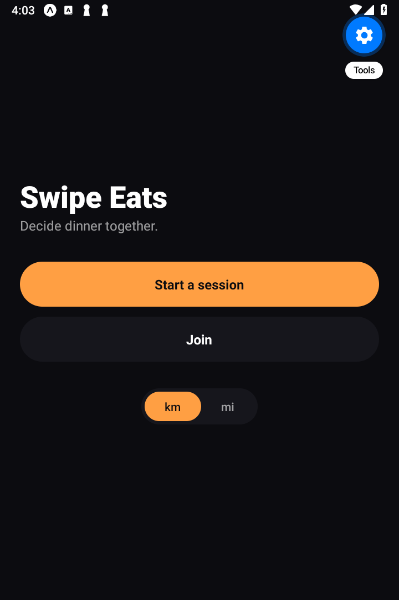
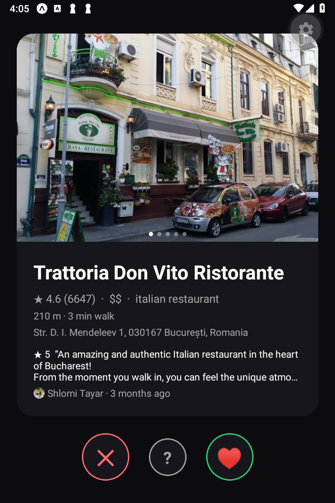
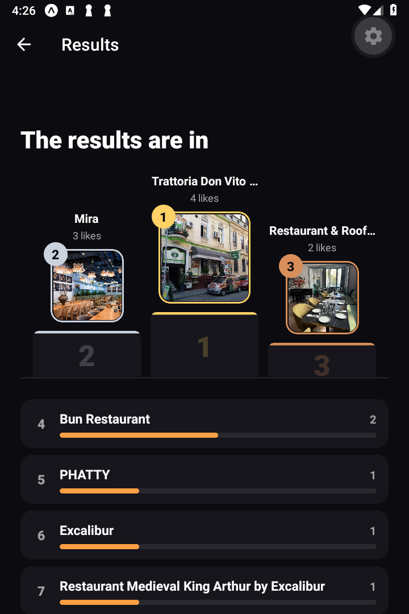
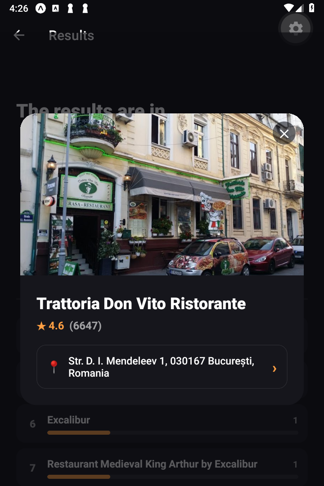

<div align="center">


# Swipe Eats

### Decide dinner together.

A swipe-to-match app for groups who can never agree on where to eat.
Everyone swipes the same shortlist of nearby restaurants on their phone;
the app tallies the votes live and crowns a winner on a podium.

[](LICENSE)


</div>

<table>
  <tr>
    <td></td>
    <td></td>
    <td></td>
    <td></td>
  </tr>
</table>

---

## What it does

Pick a place, start a session, and share a **6-character code, a QR, or a link**.
Friends join from their own phones and swipe through the same set of real,
nearby restaurants:

- **→ like**, **← pass**, or **↓ maybe** (for "I'm not fussed") — with instant,
  snappy consecutive swipes.
- Votes sync in **real time**; when everyone's done, the results screen reveals a
  **2‑1‑3 podium** with medal tiers, a ranked bar chart for the runners‑up, and the
  dishes **everyone agreed on**.
- Tap a winner for a **blurred closeup** with its photo, rating and address — and tap
  the 📍 pin to hand off to **Maps / Waze / Bolt** for directions.
- Works **solo** (a personal shortlist) and for **any group size**.
- Filters for cuisine, price, minimum rating, open‑now, and **max walking time** from
  your location, in **metric or imperial**.

Restaurant data (places, photos, reviews) comes from the **Google Places API**, proxied
through a Cloud Function so the API key never ships inside the app.

## How it works

```
  Expo / React Native app  ──►  Firebase
  ┌───────────────────────┐     ┌──────────────────────────────────────────┐
  │ swipe deck (Reanimated)│     │ Anonymous Auth   (no sign-up required)    │
  │ sessions, QR, deep link│◄───►│ Firestore        (real-time session docs) │
  │ results podium         │     │ Cloud Functions  (Google Places proxy)    │
  └───────────────────────┘     └───────────────────────────┬──────────────┘
                                                             ▼
                                              Google Places API (key stays server-side)
```

- **No accounts.** Firebase Anonymous Auth gives every device an identity; a session is
  only readable by its participants, enforced by **Firestore security rules**.
- **The Places key stays off the client.** `searchPlaces`, `placePhotos`, `placeReviews`
  and `geocode` are Cloud Functions; the key lives in **Secret Manager**.
- **Photos & reviews are render‑only.** Google's content is fetched fresh at view time and
  held in memory for the session — never written to a database or disk (per Places ToS).
- **Pure, tested logic.** Ranking, matching, swipe resolution, filters and distance are
  plain functions with **120+ unit tests**; security rules are tested against the Firebase
  emulator.

## Tech stack

| Area | Choice |
|------|--------|
| App | Expo SDK 58, React Native 0.88, TypeScript (strict), expo‑router |
| Gestures / motion | react‑native‑gesture‑handler, react‑native‑reanimated |
| Backend | Firebase Auth, Firestore, Cloud Functions (2nd gen) |
| Places | Google Places API (New), proxied server‑side |
| Testing | Jest, `@firebase/rules-unit-testing` (emulator) |
| Builds | EAS Build (App Bundle / APK) |

---

## Getting started (bring your own keys)

Swipe Eats talks to **your own** Firebase project and **your own** Google API key —
nothing is shared or hard‑coded. You'll need:

- **Node 20+** and the **Expo** tooling (`npx expo`)
- A **Firebase project** on the **Blaze** plan (Cloud Functions require it)
- A **Google Maps Platform API key** with the **Places API (New)** enabled

### 1. Clone & install

```bash
git clone https://github.com/bogdan-velicu/swipe-eats.git
cd swipe-eats
npm install
```

### 2. Create your Firebase project

In the [Firebase console](https://console.firebase.google.com): create a project, then
enable **Authentication → Anonymous** and **Firestore Database**. Point the Firebase CLI
at it:

```bash
cp .firebaserc.example .firebaserc   # then set your project id, or:
npx firebase use --add
```

### 3. Add your client config

The Firebase **web app** config values are public client identifiers (not secrets) — the
app reads them from your local `.env`, which is git‑ignored:

```bash
cp .env.example .env
```

Fill `.env` from **Firebase console → Project settings → Your apps → Web app → SDK setup**.

### 4. Add your Places key (stays server‑side) & deploy the backend

```bash
# Store the key as a Cloud Function secret — never in the client, never committed:
npx firebase functions:secrets:set PLACES_API_KEY

# Deploy functions, Firestore rules and indexes:
npx firebase deploy --only functions,firestore
```

> **Restrict your key** in Google Cloud Console to the **Places API** before deploying.

### 5. Run it

```bash
npm start          # Expo dev server (scan the QR with Expo Go)
# or
npm run android    # build & open on a connected Android device/emulator
```

## Testing

```bash
npm test           # unit tests (pure logic — 120+ tests)
npm run test:emu   # Firestore security rules against the Firebase emulator
```

---

## Building for release (EAS)

Builds use [EAS Build](https://docs.expo.dev/build/introduction/). The release build is
optimized for size: **Hermes**, **R8** code minification and **resource shrinking** are
enabled (see `expo-build-properties` in `app.config.ts`).

```bash
npm i -g eas-cli
eas login                 # free Expo account
eas build:configure
```

Your Firebase config must be available to the cloud builder. Register it once per
environment (values stay in your EAS account, not the repo):

```bash
eas env:create --environment production --name EXPO_PUBLIC_FIREBASE_API_KEY --value "..."
# ...repeat for the other EXPO_PUBLIC_FIREBASE_* vars
```

Then build:

```bash
# Shareable APK for friends (sideload):
eas build --profile preview --platform android

# Google Play bundle (.aab — Play serves the smallest per-device APK):
eas build --profile production --platform android
```

Upload the `.aab` to the [Play Console](https://play.google.com/console), or send the
`.apk` link straight to friends. To publish to Play: `eas submit --profile production`.

## Project layout

```
app/              expo-router screens (home, join, swipe, results, recap…)
src/
  features/       swipe, session, results, filters, place, join, map
  backend/        Firebase + Places client, Firestore service
  core/           pure domain logic: matching, ranking, types, units
  theme/          dark design tokens
functions/        Cloud Functions (Google Places proxy, geocode)
firestore.rules   security rules (participants-only reads, per-user writes)
docs/             deep-link setup, screenshots
```

## Privacy & Google Places

Google Places photos and reviews are fetched fresh when a card or result is shown and kept
in memory only for that session. They are **never** written to Firestore, local storage, or
the repo. Session data holds only what the group swiped; there are no user accounts.

## Contributing

Issues and PRs welcome. Please keep logic in `src/core` pure and covered by a test, run
`npm test` and `npx tsc --noEmit` before opening a PR, and match the existing dark theme
tokens in `src/theme`.

## License

[MIT](LICENSE) © 2026 Bogdan Velicu
